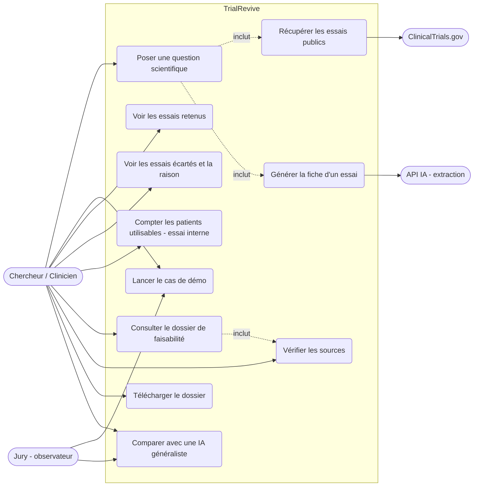
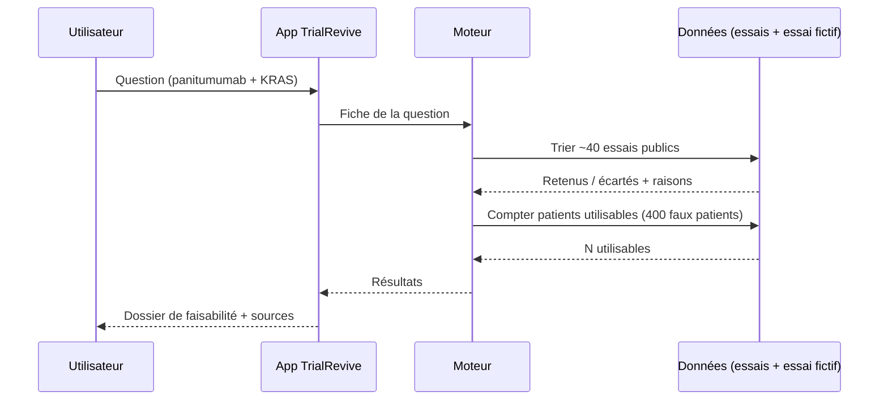

# Cas d'usage — Ce que l'utilisateur peut faire

Acteurs : **Chercheur / Clinicien** (utilisateur principal), **Jury** (voit la démo), **IA Claude** (système externe pour l'extraction).

## Diagramme

## Description des cas d'usage

| Cas | Acteur | Résultat |
|-----|--------|----------|
| Poser une question | Chercheur | La question est traduite en exigences précises |
| Lancer le cas de démo | Chercheur / Jury | Résultat complet du cas KRAS en un clic |
| Voir essais retenus | Chercheur | Liste des essais pouvant répondre, avec lien NCT |
| Voir essais écartés | Chercheur | Chaque rejet est expliqué |
| Compter patients utilisables | Chercheur | Entonnoir 400 -> N sur l'essai fictif, sans que les données sortent |
| Consulter le dossier | Chercheur | Méthode, force de preuve, gain, sources |
| Vérifier les sources | Chercheur | Chaque affirmation renvoie à un essai/publication réel |
| Télécharger le dossier | Chercheur | Export Markdown/PDF |
| Comparer avec IA généraliste | Chercheur / Jury | Tableau côte à côte honnête |

## Séquence de la démo (pour le pitch)

